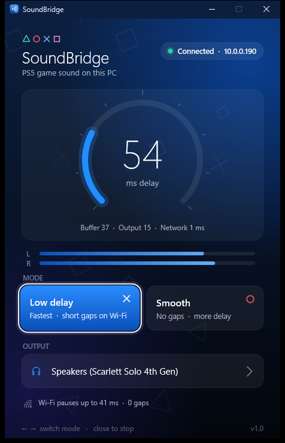

<div align="center">


# SoundBridge

**Your PS5's game sound, in the headset on your PC.**

A payload for jailbroken PS5 consoles that streams game audio over your home
network to a small Windows app, with as little delay as the network allows.
No PSN, no Remote Play, no capture card.

[**Website**](https://wwwshelton19-spec.github.io/SoundBridge-PS5/) ·
[**Download**](https://github.com/wwwshelton19-spec/SoundBridge-PS5/releases/latest) ·
[How it works](#how-it-works) ·
[Build](#build)



</div>

## Why

If your PS5 is on a monitor without speakers and your headset is plugged into
your PC (for example an audio interface like a Focusrite Scarlett), the PS5's
sound has nowhere to go. SoundBridge sends it to the PC.

## Highlights

- **Low delay.** About 50-55 ms measured on the PC side over Wi-Fi, roughly
  60-80 ms from game to ear. With Ethernet on the PS5, less.
- **Nothing to set up.** The PC app finds the PS5 by itself. Open them in any order.
- **Two modes.** *Low delay* plays as early as possible. *Smooth* keeps just
  enough buffer to ride out Wi-Fi pauses.
- **Adaptive buffer.** It measures the network and keeps only the buffer it needs.
- **PS5-style app.** A small native Windows app (Direct2D, about 250 KB, no install).
- **Plays nicely.** Runs next to other payloads. Sending it again replaces the running copy.

## Quick start

1. Download `SoundBridge_PS5_13.60.elf` and `SoundBridge_Windows.zip` from the
   [latest release](https://github.com/wwwshelton19-spec/SoundBridge-PS5/releases/latest).
2. Unzip it on the PC and open **SoundBridge.exe**. Allow it through the Windows firewall if asked.
3. Send the `.elf` to your PS5's ELF loader (port 9021), for example with PS5Upload.
4. The app turns green, *Connected*, and the game sound plays on your PC.

**Requirements:** a jailbroken PS5 with an ELF loader. It is tested on firmware 13.60 only.
The PC needs Windows 10 or 11, on the same home network as the PS5.

## How it works

```
 PS5                                         PC
 ┌──────────────────────────────┐            ┌──────────────────────────────────┐
 │ libSceAvcap2 (Remote Play     │  UDP 9399  │ jitter buffer (adaptive margin)  │
 │ mix) -> 48 kHz stereo, 21 ms  │ ─────────► │ -> drift-corrected resampling    │
 │ chunks -> 5 ms UDP packets    │  ◄──────── │ -> WASAPI (IAudioClient3, the    │
 │                               │  HELLO     │    shortest shared-mode period)  │
 └──────────────────────────────┘            └──────────────────────────────────┘
```

- **Capture.** The payload opens the system's Remote Play audio mix through
  `libSceAvcap2`, using the capture code from HearBridge. It arrives as float
  stereo at 48 kHz, in 1024-frame (21.3 ms) chunks. Smaller reads are refused
  on 13.60, so that is the floor.
- **Transport.** It sends raw 16-bit PCM, 240 frames (5 ms) per packet, so no
  packet is ever split up. The PC sends a `HELLO` every 500 ms (broadcast until
  the PS5 answers). The PS5 streams to whoever said hello last and stops 5 s after the hellos stop.
- **Playback.** The PC app keeps the *lowest* buffer level just above a margin.
  It learns that margin from the last minute of packet arrival times. A ±0.5 %
  speed trim with linear-interpolation resampling corrects clock drift. When a
  backlog builds up it is skipped, and every gap fades in and out with no clicks.

### About Wi-Fi

On the test console, the PS5's Wi-Fi went silent for 60-110 ms twice every 10 seconds,
by itself. Pinging the router and the PS5 at 100 Hz confirmed it was the PS5's link.
*Low delay* mode plays through these pauses as short, faded gaps. *Smooth* mode buffers
over them, at about 130 ms. An Ethernet cable on the PS5 avoids them completely.

## Build

**PS5 payload** (Linux or WSL, [ps5-payload-sdk](https://github.com/ps5-payload-dev/sdk) v0.43):

```sh
make ps5 PS5_PAYLOAD_SDK=/path/to/ps5-payload-sdk
```

`check_imports.sh` makes sure the ELF only imports symbols that are known to
load on this console. `sendto` and `recvfrom` are raw syscalls for that reason.

**Windows apps** (LLVM/clang plus the Windows SDK, for example from Visual Studio 2022):

```powershell
powershell -File pc\build_pc.ps1   # dist\SoundBridge.exe and dist\SoundBridge_Receiver.exe
```

`SoundBridge_Receiver.exe` is the same receiver as a text window
(`--smooth`, `--device "name"`, `--ps5 IP`, `--list`).

## Files

| Path | What |
| --- | --- |
| `src/main.c` | PS5 payload: capture loop, UDP control and stream |
| `src/avcap2.c` | `libSceAvcap2` capture (from HearBridge) |
| `src/sb_proto.h` | Wire format shared by both sides |
| `pc/sb_engine.c` | Receiver engine: network, jitter buffer, WASAPI output |
| `pc/gui.cpp` | The PS5-style window (Direct2D / DirectWrite) |
| `pc/console.c` | Text-window receiver |
| `docs/` | The project website (GitHub Pages) |

## Credits and license

- Audio capture and payload plumbing from
  [HearBridge-PS5](https://github.com/X-F1REBALL-X/HearBridge-PS5) by X-F1REBALL-X (GPL-3.0-or-later).
- Built with [ps5-payload-sdk](https://github.com/ps5-payload-dev/sdk).

SoundBridge is licensed under **GPL-3.0-or-later**. See [LICENSE](LICENSE) and [NOTICE](NOTICE).

*SoundBridge is an independent homebrew project. It is not affiliated with or endorsed by
Sony Interactive Entertainment. "PlayStation" and "PS5" are trademarks of Sony
Interactive Entertainment Inc. Use it at your own risk.*
